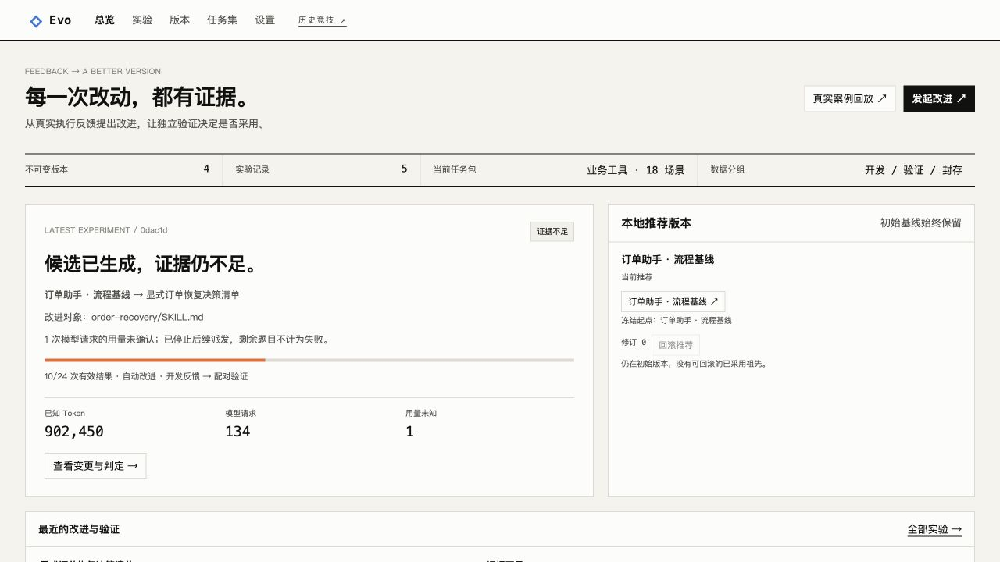

# EvoArena

项目正向 **Harness 自改进平台 Evo** 演进：通过真实任务反馈生成候选版本，验证改进是否有效，并交付可复用、可回滚的资产。新方向的完整范围见 [总体规划](docs/evo-platform-plan.md)，实现边界见 [架构方案](docs/evo-architecture.md)，进度见 [长期 Goal](TASKS.md)。业务任务包、配对评测、实验预算、取消/检查点继续和 M5 版本交付已完成；v0.2 的完整自动改进验收、独立复现与最终对照报告仍在推进。

默认首页 `/evo` 提供不可变基线、人工候选、运行前 diff 和真实版本加载实验。Pi 支持系统策略追加和原生 Skill；DSH 支持任务指令前缀，原生 Skill 尚未验证。详见 [用法与首组加载证据](docs/version-loading-check.md)。旧对战和 FixOps 历史仍在 `/harness` 与 `/fixops`。

新业务任务包有 3 类问题、18 个不同机制场景，开发/验证/封存各 6 题。页面可选择开发冒烟、重复验证或封存报告，配置实验总预算，查看逐题差异与可信验收。真实 Pi 冒烟中两版均为 3/3，报告“未观察到收益”；DSH 的永久失败补偿路径也已实际通过。见 [评测用法与边界](docs/business-evaluation.md) 和 [脱敏验证摘要](docs/m2-verification.json)。新任务不依赖旁边的桌面项目代码，但 DSH 适配器当前仍依赖已有 Harbor 工作区；独立克隆安装在 M6 完成。

M3 的“自动改进”入口已经接通：6 次开发基线 → 有证据引用的模型诊断 → 单文件候选 → 24 次配对验证 → 事务判定。可独立选择生成模型，所有调用共用预算，候选不能更换执行模型或运行器。真实模型已生成 Skill；本次验证在 10/24 次有效结果后遇到模型响应异常，以证据不足结束，没有晋升，M3 完整验收仍待完成。见 [自动改进用法与边界](docs/automatic-improvement.md)。

新协议实验支持取消与安全边界上的继续。真实 Pi/Harbor 演练在第一题持久化后强制终止控制进程，恢复后完成剩余 5 题，原 Trial 和预算截止时间保留；用量未知或业务结果未确认时拒绝重放。见 [恢复操作与实测](docs/execution-recovery.md)。

工作台现按总览、实验、版本、任务集和设置组织。可导出版本包及脱敏报告，重新绑定模型导入资产，回滚本地推荐并保留审计记录；全新工作区提供不写入用户历史的真实案例回放。见 [页面与交付用法](docs/delivery-and-workspace.md)。



EvoArena 让工具型 Agent 在可验证任务中竞争，并根据执行反馈产生候选策略。比赛、策略差异、父子配对、晋级或拒绝都有持久记录。

首个赛场 FixOps 的任务是恢复订单服务：真实 Docker 容器中运行网关和订单 API，Agent 通过受限工具检查配置、修改上游并探测健康；宿主机上的独立验证器检查健康、创建订单、查询一致性和依赖约束。

## FixOps 策略进化原型

首版已包含不可变策略版本、2 或 4 个席位、多轮比赛、真实模型生成 Child、配对准入、原子席位替换、事件回放、策略差异和本地观战页面。默认两个策略、两轮和一个候选，所有任务顺序运行。

FixOps 页面可提交自己的策略，再从“自选策略”中选择 2 或 4 个不可变版本参赛。注册策略不发起模型请求，启动赛季后才执行比赛。FixOps 的参赛单位是提示词和操作流程。

当前只有一个故障族，探索、准入和报告集采用不同服务端口变体。每个版本每轮只有一个任务实例，页面标为 SMOKE；结果用于验证闭环，不能据此声称泛化或统计显著提升。首版通过固定动作协议演化提示词与操作流程，暂不训练模型权重。

## Harness 竞技场

本地竞技场用 Harbor 运行 DeepSeek Harness 和 Pi。双方使用相同模型、题目和预算，各自在独立容器中执行。双方都有有效验收结果时，各自通过一题得一分。可以并排查看双方的独立验收、工具轨迹和补丁。维护任务取自桌面 Agent 项目的一次真实进程清理修复。故障场景会在测试账本写入成功后返回 HTTP 504，验收检查最终只写入一笔订单，以及 Agent 是否查询过状态。

在 `/settings` 添加模型连接，填写连接名称、模型 ID、API 基础地址和 API Key。当前支持兼容 OpenAI Responses API 的服务，可保存多个连接，并设置新对局的默认选择。编辑时 API Key 留空会沿用原密钥。连接保存在本机 `.evoarena/models.json`，文件权限为 `0600`，浏览器读取配置时只得到密钥是否存在。

在竞技场点击「发起挑战」，选择一个模型和参赛 Harness。默认双人对战需要两位选手，切换到「单项评测」后可只选一位。首页优先打开最新双人对战，单跑记录在历史下拉框中单独分组。对局保存启动时的模型和选手信息，后续编辑连接不影响已启动的对局。

首屏展示双方比分、逐题胜平负以及耗时和 Token 差距。得分沿用独立验收结果，效率比较只汇总双方共同通过且用量完整的同题任务，以用量较高的一方为基准计算节省比例。逐题交锋表可直接跳到相应证据，条件不一致或执行异常的任务不参与配对结论。结果仅描述当前对局。

需要一个已安装 Harbor 的本地 `harbor-eval` 工作区和包含任务原始提交的桌面项目。构建比赛镜像后，使用已有模型配置启动。

```sh
docker build -t evoarena-harbor:arena -f evo_arena/fixtures/harness/Dockerfile evo_arena/fixtures/harness
uv run evo-arena serve --profile .evoarena/local-profile.json \
  --harness-repo ../app --harbor-bin ../harbor-eval/.venv/bin/harbor
```

打开 <http://127.0.0.1:8787/harness>。Harbor 原始记录保存在 `.evoarena/harbor/`。Agent 和验收容器采用 Docker 的离线网络模式，模型请求由宿主机中继到配置的网关。每位选手每题限时 240 秒，最多派发 12 次模型请求，达到 180,000 个供应商报告 token 后停止派发下一次请求。达到赛制上限时，如独立验收已运行，则按当时的产物计分。供应商或运行器异常会让该题退出配对计分。

## 安装和模型配置

需要 macOS 或 Linux、Python 3.12+、uv 和运行中的 Docker。首次构建默认拉取 `python:3.13-slim`。

```sh
uv sync --python 3.13
```

通过进程环境提供模型信息。密钥仅保存在环境或你自己的凭据管理器中；应用不自动读取 `.env`。

```sh
export ARENA_BASE_URL='https://your-provider.example/v1'
export ARENA_MODEL='your-model'
export ARENA_API_KEY='your-key'
uv run evo-arena doctor --probe-model
uv run evo-arena serve
```

打开 <http://127.0.0.1:8787>。支持提供 `/responses` 接口的模型服务；模型通过 JSON 动作协议使用工具，不依赖供应商原生工具调用格式。`doctor --probe-model` 会产生一次真实模型请求；不带该参数只检查配置和 Docker。

可以显式导入已有 Harbor 配置和 DSH 凭据引用，无需复制密钥：

```sh
uv run evo-arena serve \
  --import-config ../harbor-eval/configs/runtime.yaml \
  --credentials ~/.dsh/.credentials.yaml
```

导入文件中的 `model.base_url`、`model.name` 和 `model.api_key_env` 会用来读取配置，凭据文件只读取对应的 `refs` 项。`ARENA_*` 环境变量优先。Harbor 和 DSH 都不是项目独立运行的必要依赖。

常用的文件引用和基础镜像可以保存在本机 JSON profile 中，字段只接受 `import_config`、`credentials` 和 `base_image`，不保存密钥值。相对路径以 profile 所在目录解析。例如已配置本机 profile 时：

```sh
uv run evo-arena serve --profile .evoarena/local-profile.json
```

## 运行一个真实赛季

先校准环境，再运行比赛：

```sh
uv run evo-arena calibrate
uv run evo-arena demo --population 2 --rounds 2 --max-calls 32 --max-tokens 220000
uv run evo-arena serve
```

网页上的开始赛季也会运行真实模型。轮次和种群变化时会调整页面展示的请求上限；CLI 增大种群时请显式设置预算。模型请求数是硬上限；token 按供应商报告累计，在新请求发起前检查，正在执行的一次请求可能使累计超过阈值。遇到用量未知的请求停止继续调用，不能把未知计为零。暂不估算货币费用。

本地镜像拉取受限时，可以通过 `--base-image <可运行 python3 的本地镜像>` 构建同一个场景。环境收据会记录实际基础镜像、镜像 ID、架构和场景源码摘要。2026 年 11 月 3 日的首次实验使用已缓存的 `alexgshaw/openssl-selfsigned-cert:20251031`，架构为 amd64；只采用任务通过数决定晋级，不以该环境耗时声称性能提升。

```sh
uv run evo-arena calibrate --base-image alexgshaw/openssl-selfsigned-cert:20251031
```

命令均可接受 `--data-dir`，默认持久目录为 `.evoarena/`，已排除在 Git 之外。导出一个赛季：

```sh
uv run evo-arena export --season <season-id> --output .evoarena/reports/season.json
```

也可以在命令行注册策略并选择参赛版本。`--version` 重复两次或四次，版本 ID 来自注册输出：

```sh
uv run evo-arena register --name '我的策略' --policy-file ./my-policy.txt
uv run evo-arena demo --version <version-a> --version <version-b>
```

## 比赛和进化规则

每个任务获得新环境，运行记忆在任务间清空；策略通过不可变版本显式继承。同一赛季固定模型、三次动作预算和工具权限。动作包括检查、修改配置、健康探测和提交；最终通过与否由独立业务验证器决定。

前两名轮换成为 Parent。进化器只读取探索任务反馈，生成新策略、修改理由和差异。Parent 和 Child 在同一准入端口变体上重跑，只有 Child 严格增加任务通过数、且没有配对实例退化时才晋级。平分会被拒绝；环境或供应商异常会使判定待评。Parent 和被替换的末位席位可以不同。

最后一轮完成后才打开最终报告变体，比较初始版本与最终仍在席的版本。该结果不回流当前赛季选择。被拒绝的候选仍保留策略、轨迹和准入理由。

## 系统边界

```text
本地浏览器 → HTTP 控制面 → SeasonRunner
                            ├─ SQLite 版本、席位、决定、事件
                            ├─ Responses 模型与候选生成
                            └─ 受限动作工具 → Docker 网关和订单服务
                                             ↑ 宿主机独立业务验收
```

Agent 的模型循环在宿主控制面运行，只能调用四个受限工具。API Key 不进入容器、事件或页面。容器只读根文件系统、移除 capabilities、限定 CPU/内存/PID，配置目录只读挂载；模型可以通过受限配置工具请求修改唯一的业务字段。宿主机运行 Docker，不向参赛 Agent 暴露其管理接口。

SQLite 保存策略版本、赛季、运行、候选、准入和游标事件。晋级在同一事务中校验席位版本并落盘决定与事件；重复决定不会再次替换，过期席位写入会被拒绝。单个数据目录通过文件锁限制只有一个执行控制面。

旧赛季在进程重启后标为 interrupted，需要新赛季重试；新的 `/evo` 实验按 [检查点恢复协议](docs/execution-recovery.md) 核对资源与用量后显式继续。未知结果不自动重放。它是单机执行平台，尚不提供分布式 Worker 租约、运行中自动接管或多租户服务。

## 验证

```sh
uv run python -m unittest discover -s tests -v
uv run evo-arena calibrate
EVOARENA_DOCKER_TESTS=1 uv run python -m unittest discover -s tests -v
node --check evo_arena/static/app.js
```

测试覆盖不可变快照、晋级事务和重试、过期写入、父子配对覆盖、退化拒绝、预算、供应商错误与重定向、完整进化链，以及可选的真实 Docker 业务验证。测试中使用的可控 Agent 只存在于临时数据库，不会作为真实比赛记录进入页面。

[首场真实实验](docs/first-experiment.md) 保留实际结果及其解释；[面试演示说明](docs/interview-demo.md) 组织讲解和技术边界；[长任务清单](TASKS.md) 记录交付范围和后续工作。
