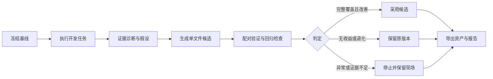

# Evo — Harness 自改进工作台

从真实任务反馈中发现问题，生成可检查的 Skill 或策略改动，在同一条件下验证，再决定采用或保留原版本。

Evo 连接 **DSH / Pi、Harbor、模型配置、不可变版本和独立验收**。一次实验回答六个问题：为什么改、改了什么、是否实际加载、哪些题改善或退化、花了多少预算、为什么接受或拒绝。

**状态：v0.2 正在验收。** 版本加载、业务任务、预算、恢复、资产交付和独立安装已有真实证据；完整自动改进、反馈对照与封存报告仍待验收。当前不宣称进化带来质量提升。进度见 [TASKS](TASKS.md) 和 [逐项验收台账](docs/v02-acceptance.md)。


图中是已保存的真实失败案例：模型生成了 Skill，验证因用量未知停止，推荐版本没有改变。空工作区可以只读回放此案例，不会写入用户的实验历史。

## 一次改进如何发生



一次自动改进执行 6 次开发基线，最多生成一个候选，再执行 24 次验证：6 题 × 2 次重复 × 双版本。默认只改一个授权文件，执行模型、运行器及其他文件保持固定。生成模型可以独立配置。

默认准入要求完整有效覆盖、逐题成功数不退化、总成功数严格增加、关键业务约束零违规。平分保留原版本；异常和缺失样本不能按策略失败或零成本处理。采用只更新本地项目推荐，导出的资产由用户自行使用。

## 核心能力

| 模块 | 已实现的行为 |
| --- | --- |
| 版本与加载 | 策略、Skill、运行器和模型身份形成不可变版本；核对容器文件哈希、注册和实际模型输入 |
| 诊断与候选 | 开发证据引用、假设、单文件 diff、原始响应留存；验证与封存详情不回流本次生成 |
| 评测与判定 | 固定任务包、独立验收、重复配对、逐题差异，分别报告改善、无收益、退化与证据不足 |
| 可靠执行 | 实验总预算、幂等提交、取消、资源对账、已确认 Trial 边界上的继续；未知调用不重放 |
| 资产交付 | ZIP 导出/导入、显式模型绑定、脱敏报告、本地推荐回滚及审计记录 |
| 反馈对照 | 同初始版本、同搜索机会和预算上限，对照生成器不读取开发执行反馈；封存结果单独报告 |

Pi `0.82.1` 支持系统策略追加和原生 Skill，已证明 Skill 正文进入模型上下文。DSH `0.1.2-rc.1` 支持任务指令前缀，原生 Skill 尚未验证。能力以适配器声明为准。[加载证据](docs/version-loading-check.md)

## 首个领域：业务工具 Agent 的可靠执行

Agent 在隔离账户中调用工具，独立验收器核对业务账本及操作约束。任务由真实运行器执行，业务服务为可控的模拟环境。

| 问题族 | Agent 要解决的问题 |
| --- | --- |
| 下单结果核对 | 回执超时、写入未发生或仍在处理中时，确认实际状态并避免重复下单 |
| 完整订单对账 | 处理分页、延迟索引、快照变化和多 revision，得到完整且一致的清单与金额 |
| 履约与补偿 | 复用已有库存占用，完成确认；有永久失败证据时取消并释放占用 |

任务包有 18 个实例，开发、验证、封存各 6 个。校准覆盖正确解、空操作和典型错误解。小样本用于验证机制，不作为行业基准或统计显著性证据。[业务协议与边界](docs/business-evaluation.md)

## 本地启动

需要 macOS 或 Linux、Python 3.12+、uv、Node.js 22+ 和运行中的 Docker。首次安装及镜像构建需要联网。

```sh
git clone https://github.com/LianWeiSQ/harness-arena.git
cd harness-arena
uv sync --frozen --extra harbor --python 3.13
docker build -t evoarena-harbor:arena -f evo_arena/fixtures/harness/Dockerfile evo_arena/fixtures/harness
uv run --frozen --extra harbor evo-arena calibrate-business
uv run --frozen --extra harbor evo-arena serve
```

打开 [本地工作台](http://127.0.0.1:8787/evo)。校准预期为 18 个正确解通过、18 个空操作与 18 个错误解拒绝，模型调用为零。

1. 在**设置**检查依赖，添加支持 Responses API、工具调用和用量报告的模型连接。
2. 在**版本**创建 Pi 或 DSH 基线，填写策略；Pi 可加入 Skill。
3. 在**实验 → 配置新实验**选择基线、自动改进、允许修改的文件和总预算。
4. 查看诊断引用、候选 diff、实际加载和逐题结果，再导出资产与报告。

创建版本和查看案例不调用模型；启动实验会使用真实模型预算。默认一次自动改进上限为 363 次请求、3,000,000 Token 派发阈值和 4 小时。最后一次响应可能跨过 Token 阈值，未知用量另记，平台不编造货币费用。

只浏览工作台可使用 `uv run --frozen evo-arena serve`，无需 Docker、Harbor 或模型密钥。完整实验需要 Harbor extra；DSH/Pi 安装在任务镜像内，无需安装到个人终端。该路径不依赖相邻私有仓库。模型配置保存在本机 `.evoarena/`，凭据不会进入报告或 Git。[完整安装与排障](docs/installation.md)

## 可复核的证据

- **真实加载：** Pi 的策略与 Skill、DSH 的指令前缀已经验证；独立安装的四次加载检查全部通过。[M1](docs/version-loading-check.md) · [M6 安装记录](docs/m6-installation-verification.json)
- **崩溃恢复：** 首题检查点保存后强制终止控制进程，恢复完成其余五题，首题未重跑、原预算截止时间保留。[M4 演练](docs/execution-recovery.md)
- **资产交付：** 页面导出真实 Skill，在独立目录绑定模型后导入，文件逐字一致；推荐回滚保留原判定历史。[M5 验证](docs/delivery-and-workspace.md)
- **自动改进：** 已由模型生成并实际加载新 Skill。早前两轮在 10/24 和 2/24 次有效验证后因模型响应异常停止；失败记录保留。独立登记的 `feedback-02` 也在 22/24 后因连接/读取异常停止，尚无完整质量结论。[自动改进](docs/automatic-improvement.md) · [反馈对照与报告核对](docs/feedback-control.md)

测试中的可控 Agent 只写临时数据库，不作为真实模型成绩进入工作台。CI 检查锁定安装、Harbor 契约、事务与恢复、报告一致性、业务校准、前端语法和仓库外 wheel；不付费调用模型，也不替代真实研究。

```sh
uv run --frozen --extra harbor python -m unittest discover -s tests
uv run --frozen --extra harbor evo-arena calibrate-business
node --check evo_arena/static/evo.js
node --check evo_arena/static/settings.js
```

## 架构与扩展

本地 HTTP 控制面协调 SQLite 中的版本、实验、预算和判定；Harbor 管理独立任务与验收容器；宿主网关中继模型请求并记录用量。模型密钥留在宿主侧，任务容器离线运行。当前是单机、单用户、单活动 Trial 的执行平台。

扩展入口包括领域任务、Harness 注入面和候选生成器。记忆、检索、工具、模型路由、工作流和协作列入后续路线；模型权重训练、多租户托管和分布式 Worker 尚未实现。

[产品全景](docs/evo-platform-plan.md) · [架构与故障边界](docs/evo-architecture.md) · [扩展指南](docs/extensions.md) · [面试演示](docs/interview-demo.md)

旧竞技页 `/harness` 和 FixOps 赛季 `/fixops` 保留历史与兼容入口，使用方式见 [历史 Arena 文档](docs/legacy-arena.md)。仓库及 Python 包继续沿用 `harness-arena` / `evo-arena` 名称。
