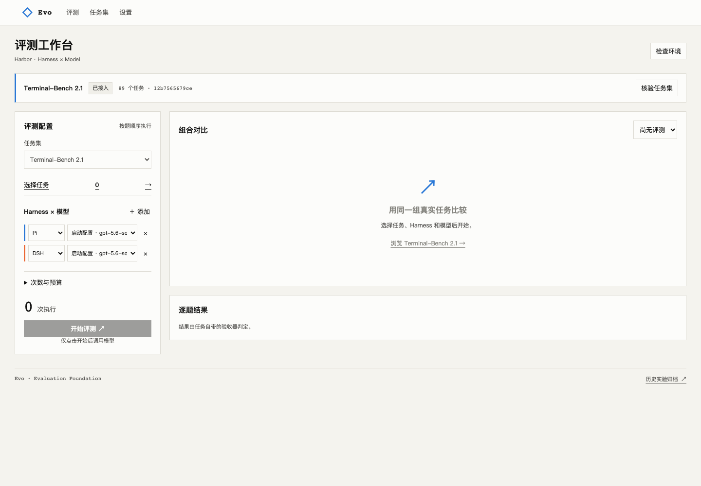

# Evo — Harness 评测与进化平台

使用真实 Harbor 任务，比较 **DSH / Pi × 不同模型** 的完成情况，并为后续评测驱动的版本进化保存证据。

首页展示 **Harness × 模型评分榜、执行效率、逐题对比和最近评测**，默认查看最近一场完整评测，支持切换历史记录。原评测工作台继续用于配置和执行任务。默认任务集为 **Terminal-Bench 2.1 的 89 道官方任务**，固定官方仓库提交，保留题目、容器环境和验收器。历史自建业务题已退出当前目录和启动入口，历史实验仍保留。自建评测集可通过 Harbor 目录导入。



## 使用

```sh
git clone https://github.com/LianWeiSQ/harness-arena.git
cd harness-arena
uv sync --frozen --extra harbor --python 3.13
uv run --frozen --extra harbor evo-arena serve
```

打开 [首页](http://127.0.0.1:8787/) 查看已有评分；点击「发起评测」进入 [工作台](http://127.0.0.1:8787/evo)：

1. **设置**：添加支持 Responses API、工具调用和用量报告的模型连接。
2. **接入官方任务集**：下载并校验固定版本的 Terminal-Bench 2.1；不会调用模型。
3. **任务集**：按名称、分类筛选并勾选任务，可选择单题、子集或全套。
4. **评测**：配置 DSH / Pi 与模型组合、重复次数、单题预算，点击「开始评测」。
5. 回到首页查看评分与效率对比；点击单题结果进入对应执行记录，查看验收器输出、执行轨迹和模型用量。
6. 异常或中断后点击「重试并继续」：保留有效成绩，补跑异常与未执行任务。详情可切换每次尝试，耗时和用量累计包含重试。

当前机器需要 Git、Docker 和 Harbor。运行器会在官方任务容器中安装，无需宿主机安装 DSH/Pi，也不依赖相邻私有仓库或旧自建任务镜像。首次运行需要下载任务镜像、Node 和运行器依赖。

## 评测协议

- 固定任务来源提交和文件校验和；不改题、不替换官方验收器。
- 各组合使用同一任务选择、重复次数和单题预算；顺序执行，关闭自动重试。
- 保留官方执行与验收时限。Pi `0.82.1`、DSH `0.1.2-rc.1`、Node `22.22.0` 固定。
- 仅完整的二值验收结果计算组合通过率。执行异常、未执行和未知用量单独标记；自建任务的连续或多维得分原样展示。
- 首页评分为本场通过率 × 100，同分并列；不同场次、任务集或任务子集不混合排名。子集覆盖数始终显示，异常或缺失结果不会折算成 0 分。耗时包含环境准备，Token 为记录用量，不估算价格。
- API Key 留在宿主机，由单题网关代理 Responses 请求；容器只得到本地中继配置。
- 默认每题 128 次请求、1,000,000 Token 派发阈值，可在页面调整。最后一次响应可能超出 Token 阈值。模型连接异常或预算耗尽时停止派发后续题目。
- 停止请求不重放已发出的调用；服务重启将未完成评测标记为中断，不自动重跑。

子集结果、单次结果或平台限制下的结果不等同于官方榜单成绩。GPU、网络、内存等要求按任务原配置执行，页面展示资源需求。

## 自建评测集

在「任务集 → 导入自建评测集」填写名称和服务器本机目录。支持单题或多题目录：

```text
my-dataset/
  task-a/
    instruction.md
    task.toml
    environment/Dockerfile
    tests/test.sh
```

导入时校验 Harbor 格式、复制内容快照并记录校验和。后续修改原目录不改变已经接入的版本；修改后再次导入形成新的快照。题目内容和实际运行记录均保存在本机 `.evoarena/`，不进入 Git。

## 接入验证与边界

本阶段验证任务格式、运行器安装、任务选择与调度、结果解析、取消和页面交互；按用户要求，没有发起真实模型评测，也没有生成成绩。记录见 [Terminal-Bench 接入](docs/terminal-bench-integration.md)。

通用任务集上的自动诊断、候选生成与逐代筛选尚未接入。旧的单文件业务题改进流程保留为历史实现，网页启动接口已关闭，不能将其作为新任务集的进化能力。

```sh
uv run --frozen --extra harbor python -m unittest discover -s tests
node --check evo_arena/static/benchmarks.js
```

## 历史实现与证据（原业务任务流程）

- **真实加载：** Pi 的策略与 Skill、DSH 的指令前缀已经验证；独立安装的四次加载检查全部通过。[M1](docs/version-loading-check.md) · [M6 安装记录](docs/m6-installation-verification.json)
- **崩溃恢复：** 首题检查点保存后强制终止控制进程，恢复完成其余五题，首题未重跑、原预算截止时间保留。[M4 演练](docs/execution-recovery.md)
- **资产交付：** 页面导出真实 Skill，在独立目录绑定模型后导入，文件逐字一致；推荐回滚保留原判定历史。[M5 验证](docs/delivery-and-workspace.md)
- **自动改进：** 已由模型生成并实际加载新 Skill。早前两轮在 10/24 和 2/24 次有效验证后因模型响应异常停止；失败记录保留。独立登记的 `feedback-02` 也在 22/24 后因连接/读取异常停止，尚无完整质量结论。[自动改进](docs/automatic-improvement.md) · [反馈对照与报告核对](docs/feedback-control.md)

测试中的可控 Agent 只写临时数据库，不作为真实模型成绩进入工作台。CI 检查锁定安装、Harbor 契约、事务与恢复、报告一致性、业务校准、前端语法和仓库外 wheel；不付费调用模型，也不替代真实研究。

```sh
uv run --frozen --extra harbor python -m unittest discover -s tests
uv run --frozen --extra harbor evo-arena calibrate-business
node --check evo_arena/static/evo.js
node --check evo_arena/static/settings.js
```

## 架构与扩展

本地 HTTP 控制面协调 SQLite 中的任务集、组合和运行记录；Harbor 管理任务容器及原始验收流程；宿主网关中继模型请求并记录用量。模型密钥留在宿主侧，任务联网要求沿用评测集配置。当前是单机、单用户、单活动 Trial 的执行平台。

扩展入口包括领域任务、Harness 注入面和候选生成器。记忆、检索、工具、模型路由、工作流和协作列入后续路线；模型权重训练、多租户托管和分布式 Worker 尚未实现。

[产品全景](docs/evo-platform-plan.md) · [架构与故障边界](docs/evo-architecture.md) · [扩展指南](docs/extensions.md) · [面试演示](docs/interview-demo.md)

旧竞技页 `/harness` 和 FixOps 赛季 `/fixops` 保留历史与兼容入口，使用方式见 [历史 Arena 文档](docs/legacy-arena.md)。仓库及 Python 包继续沿用 `harness-arena` / `evo-arena` 名称。
