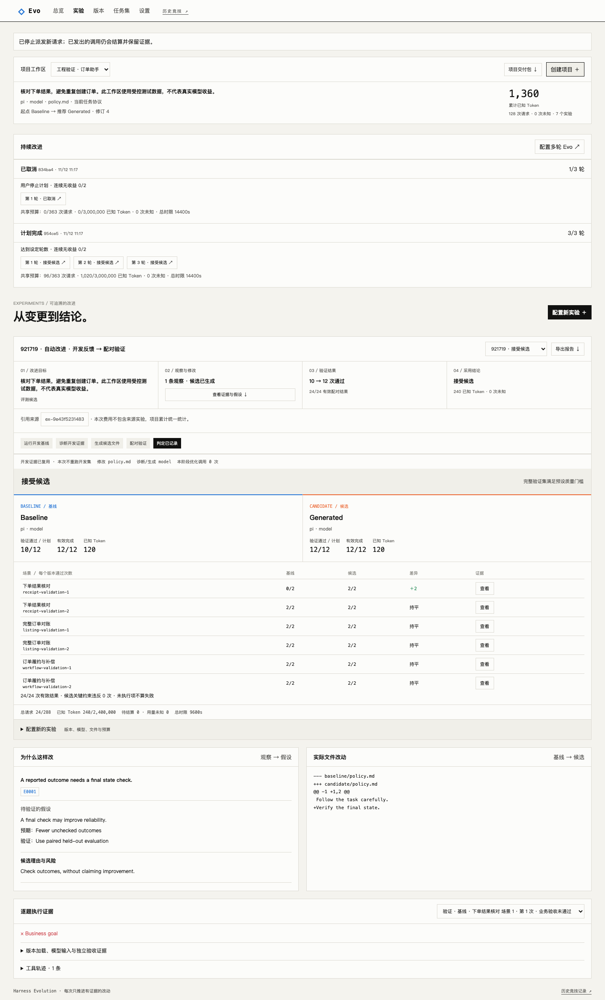

# 持续改进工作台（2026-11-12）

这一阶段把单次实验连接成持续使用的项目。业务领域仍是订单工具 Agent 的可靠执行，每个项目固定一个初始版本、任务包、改进文件和反馈方式。目标文本用于说明业务意图；实际评测依据仍由固定任务包定义，不会因为目标描述改变验收器。

## 从页面使用

1. 在“设置”配置模型；在“版本”保存 DSH 或 Pi 的策略/Skill 基线。
2. 点击顶部“创建项目”，填写目标，选初始版本和一个改进文件。保存不调用模型。
3. 在项目中点击“发起改进”，选择“分析执行反馈”。完成后查看观察、证据引用与假设。
4. 点击“下一步：生成候选”。此步骤引用保存的诊断，生成一个文件变体，不重跑开发任务。
5. 检查实际 diff，再点击“下一步：评测候选”。运行 24 次配对验证，通过准入后更新同一项目的推荐版本。
6. 单次流程明确后，可以配置“多轮 Evo”，设置最多轮数、连续无收益上限和整个计划共享的预算。

也可直接选择“完整改进”，一次串联开发、诊断、候选和验证。阶段完成与候选被采用分别显示；仅有诊断或候选时不显示验证胜负。实验页集中显示目标、观察、修改、逐题结果、调用用量和采用结论，来源按钮可以回看原始证据。

项目累计只加总该项目各实验的实际账本。阶段引用不复制 Trial、不复制费用；多轮计划总账也不会再次加进项目成本。已知 Token、用量未知和待结算分别显示。Token 是模型报告用量，不是人民币或美元账单。

旧的隐式项目保持可读。使用多轮功能需从版本创建显式项目。来源复用要求项目、当前基线、任务包、目标文件、反馈方式和执行代码指纹一致；升级代码后的旧记录可以查看，但不能直接作为新阶段来源。来源的检查点、冻结意图及产物哈希都要通过校验，资源必须已清理。

## 多轮执行的边界

每轮最多生成一个候选。接受后用新推荐继续；无收益或退化则保留父本，累计连续无收益次数。达到轮数或连续无收益上限后正常结束。执行异常、未知用量、预算耗尽、项目回滚或模型配置变化会停止计划，已经得到的证据仍保留。

所有轮次共用一个持久预算。每次调用声明、结算会同时更新实验与计划账本；重复结算不重复计费。请求上限在派发前检查，Token 阈值按返回用量检查，所以最后一笔已发出请求可能使已知 Token 超出阈值。子实验截止时间不晚于计划截止时间，首轮镜像内容 ID 与 Harbor 版本沿用到后续轮次。

取消会阻止新的调用与推荐提交，已发出的请求仍结算。取消发生在某轮已经提交推荐之后，不撤销这个已完成的决定，但阻止下一轮。进程重启会把未结束计划标为中断，pending 调用转成未知，不自动继续，也不能单独恢复该计划的子实验；保留当前推荐后可另建新计划。

这是单机单所有者的顺序控制器。轮数最多 5，当前预算上限为 1,000 次请求、1,000 万 Token、12 小时。每轮另有完整改进的预算上限。多轮重复使用验证集会产生选优偏差，只能说明这组验证任务上的结果；泛化收益仍需冻结起点、独立封存报告及等搜索预算对照。

## CLI：与页面使用同一个服务

先启动本地服务。以下命令不会另起执行引擎或直接修改正在使用的数据库；`start` 只提交任务，之后用 `show` 查看状态。写入命令打印幂等键，网络错误后请使用相同配置和键重试。

```sh
evo-arena project list
evo-arena project create --file project.json --key project-01
evo-arena project show PROJECT_ID
evo-arena experiment start --file diagnose.json --key diagnose-01
evo-arena experiment show EXPERIMENT_ID
evo-arena experiment report EXPERIMENT_ID -o report.json
evo-arena campaign start --file campaign.json --key campaign-01
evo-arena campaign show CAMPAIGN_ID
evo-arena campaign cancel CAMPAIGN_ID
```

`project.json`：

```json
{
  "name": "订单助手",
  "goal": "核对下单结果，避免重复创建订单",
  "baseline": "VERSION_ID",
  "target": "policy.md",
  "feedback_mode": "development"
}
```

`diagnose.json`：

```json
{
  "mode": "improve",
  "stage": "diagnose",
  "project": "PROJECT_ID",
  "baseline": "CURRENT_VERSION_ID",
  "target": "policy.md",
  "optimizer_profile": "startup",
  "limits": {"calls": 74, "tokens": 700000, "seconds": 3000}
}
```

生成阶段将 `stage` 改为 `propose`，添加 `source: "DIAGNOSIS_EXPERIMENT_ID"`；验证阶段使用 `stage: "validate"` 与候选阶段的实验 ID。两者仍需相同项目和当前基线。生成阶段通常最多 1 次优化调用；配对验证最多 288 次执行模型调用，不能沿用单次生成的预算。

`campaign.json`：

```json
{
  "project": "PROJECT_ID",
  "optimizer_profile": "startup",
  "max_rounds": 3,
  "no_gain_limit": 2,
  "limits": {"calls": 363, "tokens": 3000000, "seconds": 14400}
}
```

上述总预算由所有轮次共享，不保证足够完成每轮。每条命令支持 `--server http://127.0.0.1:PORT`，只连接本机服务。

## 项目交付包

页面顶部“项目交付包”或 CLI 导出整个项目快照：

```sh
evo-arena project export PROJECT_ID -o project.zip
evo-arena package inspect project.zip
evo-arena package import project.zip --model-profile startup --key import-01
```

ZIP 包括项目目标、固定起点与推荐、逐版本资产包、各阶段报告、任务协议指纹、多轮计划配置和逐文件哈希。报告保留来源实验 ID、分阶段成本、覆盖和判定；不导出配置中的端点或凭据、原始轨迹或原始模型响应。用户填写的项目名称/目标、策略/Skill 文件按原文保留。

在独立目录启动 `evo-arena serve --data-dir NEW_DIRECTORY --port 8796`，配置模型连接，然后给导入命令加 `--server http://127.0.0.1:8796` 即可复用。必须匹配模型 ID、支持的运行器版本和当前任务包。历史协议只能查看报告或单独导入版本资产。

导入把源推荐变成一个新的、尚未在本机验证的项目起点；本地修订号和费用从零开始，保存源项目、源版本与本地版本映射。原实验报告留在交付包中，不导入本地实验/判定，不继承采用资格。模型连接显式重新绑定。资产逐个幂等导入，意外中断可留下有效资产；使用同一键重试补齐，不重复创建项目。

包上限 8 MB、250 条目；逐层检查内容哈希、路径、大小和报告一致性，不向文件系统解压外部路径。哈希用于发现损坏，不代表发布者签名。

## 验收与现阶段限制

本阶段未调用用户模型，也未重跑旧研究。新增工作流在隔离数据库和受控优化器/Trial 上验收，不能把这些测试分数当成进化收益。

- 三步链路：开发诊断 7 次受控调用、生成 1 次、配对验证 24 次；累计 32 次，来源不重复计费。
- 三轮链路：96 次调用共用预算，接受后连续推进；初始版本保留；连续无收益、未知用量、取消、进程恢复及重复结算分别测试。
- 浏览器：创建项目、阶段切换、三轮执行、取消、源证据跳转、导出、空项目及项目切换；1440px 与 390px 页面无横向溢出。
- 独立安装：wheel 在仓库外运行 CLI，五份资产导入空数据库，文件一致；重复导入得到同一项目，实验、调用和推荐历史不移植。
- Node 独立验收器校准：18 个正确解通过，18 个空操作和 18 个错误解拒绝，模型调用 0。

可运行以下受控浏览器演练；需自行提供 Playwright 环境，它不属于生产运行依赖：

```sh
python tests/manual_workspace_server.py
# 另一个终端，使用已安装的 playwright 或设置 EVO_PLAYWRIGHT_MODULE 为其模块绝对路径：
node tests/manual_workspace_browser.mjs
```

该演练服务固定在 8795，使用临时目录；测试截图与结果写入已忽略的 `.evoarena/`。它不连接真实模型，不写入用户服务的历史。

M3/M6 的真实完整自动改进、封存报告和反馈对照仍未完成。后续恢复真实评测时，以新实验补齐证据，保留旧中断记录。


