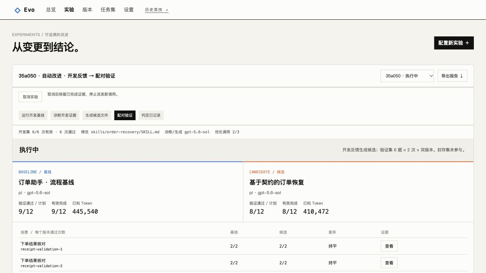
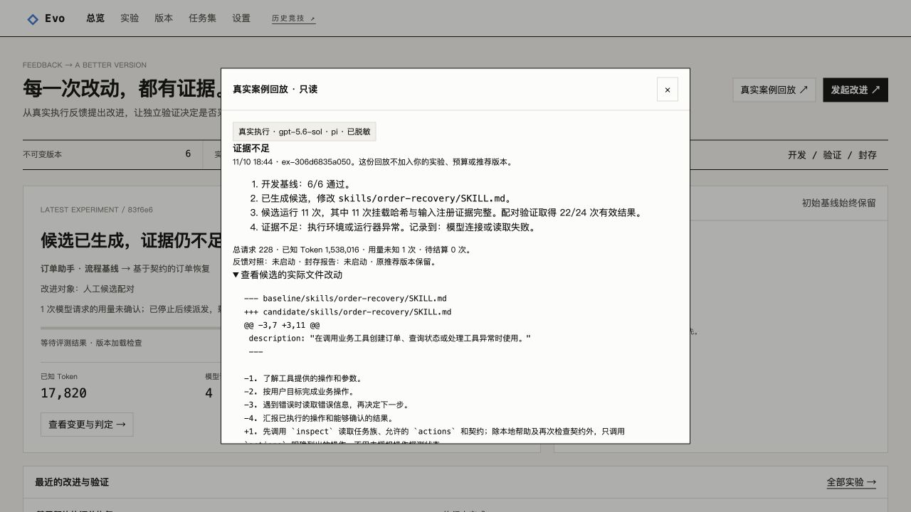
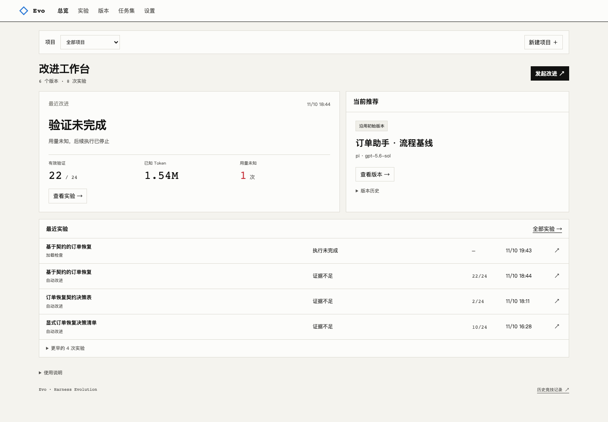

# Evo 工作台与版本交付（M5）

新增项目工作区、分步执行、多轮计划和项目级交付见 [持续改进工作台](continuous-workspace.md)。

工作台使用“总览 / 实验 / 版本 / 任务集 / 设置”。蓝色表示基线，橙色表示候选；结论同时显示文字，未完成验证不会展示为收益。旧竞技页仍在 `/harness`，旧赛季在 `/fixops`。

## 从总览进入一次改进

首次打开先配置模型，再保存策略或 Skill 为不可变基线。总览里的“真实案例回放”来自已脱敏的真实 Pi 实验，标注为只读，不加入用户数据库、预算或推荐版本。这场案例展示了生成 Skill 后因用量未知而停止的结果，并不宣称完整验证通过。

当前只读案例为 `feedback-02`：开发 6/6，通过候选文件实际加载检查后取得 22/24 次有效验证，随后因连接/读取异常停止；对照与封存未启动。页面根据报告生成结论、覆盖、运行器和费用，提供实际 Skill 文件 diff；不再把某场实验的故事写死在前端。历史失败仍保留，完整案例需等待新研究验收。

已有记录时，总览先展示最近判定、改动文件、有效覆盖、已知 Token 和未知用量。右侧是项目当前推荐与冻结起点。实验页先展示结果，启动表单默认收起；点击“配置新实验”再选择版本、目标文件、执行方式与预算。

自动改进固定执行模型和运行器，诊断模型可以独立选择。人工配对必须选择有父子关系的基线与候选。逐题表只有双方重复次数都完整时才计算差异；“未齐”不会显示为胜负。“查看”跳到相应 Trial 的验收、加载证据和工具轨迹。

## 版本包：导出、导入与复用

版本页展示只读文件、内容哈希、父子关系和独立实验记录。选择版本后可以改进、手动创建候选或导出 ZIP。

版本包包含：

- `package.json`：包协议、运行器及版本、模型 ID、原版本来源标识、逐文件 SHA-256 和元数据哈希。
- `policy.md` 与 `skills/<name>/SKILL.md`：实际文件原文，不经过模型重写。

模型连接的地址、profile 和凭据不从配置写入版本包。策略文件按原文导出。实验预算、评测协议、镜像与 Harbor 信息在实验报告中；结合版本包和报告，再提供自己的模型连接，才能复现实验配置。

导入时必须显式选择本地模型连接，模型 ID 和支持的运行器版本须匹配。平台校验包大小、展开大小、条目数量、文件路径、哈希及 Skill 结构；不解压到任意目录，不接受路径穿越、符号链接、加密包或未知文件。导入保留文件字节并形成新的本地基线，重新绑定模型连接，记录来源；不继承源版本的父子关系、评测成绩或推荐资格。相同资产和绑定重复导入复用本地版本。

内容哈希用于一致性校验，不是发布者签名。包中的原版本来源是来源记录，不能用来伪造本地已通过的判定。

## 实验报告

实验页“导出报告”下载 JSON，包括固定计划、任务包和源码指纹、镜像与 Harbor 版本、版本和文件哈希、逐项结构化验收、加载核对、逐题结果、判定与分阶段成本。旧实验缺失的字段保留为空，不补造历史证据。

报告使用字段白名单，排除模型连接配置、原始轨迹、候选正文、模型原始响应和任意异常字符串。加载收据只有与不可变版本完全匹配时才展开；不匹配的原始收据不会进入报告。已知 Token、未知调用和待结算调用分别保留。运行中导出的内容只是当时快照，不是最终报告。

## 推荐版本回滚

总览点击“回滚推荐”，选择本项目曾采用的祖先版本并填写原因。当前仍是初始版本时没有可回滚目标。未通过验证的候选、其他分支和其他项目的版本不能借此成为推荐。

回滚在一个事务内更新推荐指针、递增修订号、追加不可变变更记录和审计事件。它不修改策略文件、原始实验、旧 Decision 或冻结初始版本。重复请求返回同一回滚记录；陈旧页面收到冲突，不覆盖新状态。正在执行的实验即使后来取得好成绩，也必须通过项目版本与修订号校验才能更新推荐，因此不能覆盖较新的回滚。

## 任务集与设置

任务集页解释下单结果核对、完整订单对账、履约与补偿三类业务目标，展示开发/验证/封存分组及数据指纹。新实验使用当前可执行任务包；历史包可查看，以区分不同协议。不能把旧包的结果直接并入新包。

“校准验收器”在宿主机执行参考解、空操作和错误解，再交由独立 Node 验证器检查；覆盖 18 个场景，不调用模型，也不是 Agent 成绩。设置页保留模型连接管理，并能检查 Docker、Harbor、任务镜像、Node、数据目录、运行器能力和默认预算。每场实验仍可单独指定预算。

## 验收证据

M5 的桌面、390px 窄屏、空数据引导、真实案例回放、逐题证据跳转、下载、导入与回滚均经过浏览器操作验证。真实生成的 `order-recovery` Skill 已从页面导出，在独立测试目录重新绑定连接并导入，文件逐字一致；用户原实验库没有加入模拟成绩。推荐回滚在独立模拟数据中验证，真实项目仍保留原推荐版本。

`tests/test_delivery.py` 覆盖版本包往返、异常包、模型绑定、事务回滚、重复请求、陈旧回滚、运行中实验与回滚的冲突、报告字段范围、成本一致性和真实校准。详细结果见 [M5 验证记录](m5-verification.json)。

后续在真实运行中的 `ex-306d6835a050` 修正了两处状态提示：只有已停止实验仍有未清理资源时才显示阻塞警告；连接恢复后自动清除刷新错误，保留用户操作产生的提示。通过只读代理模拟断连并恢复，验证了自动清除，未新增模型调用。下图是 17/24 次有效验证时的运行快照，不是完整质量结论。

只读案例更新后再次核对公开源报告、服务返回和不可变实验中的 diff，三者一致。桌面及 390px 窄屏验证通过，弹窗内容宽度与滚动宽度均为 356px；本地仍为 6 个版本、8 场实验，无新增模型调用。以下截图展示真实停止记录和可展开的文件改动。

M5 不代表 v0.2 已完成。独立克隆安装已有验证；完整真实自动改进协议、封存对照与等搜索预算反馈消融仍按 [TASKS.md](../TASKS.md) 推进。

## 2026-11-12：收紧默认信息层级

总览优先显示最近一次自动改进的结果、当前推荐和发起操作，最近实验只展开四条。项目配置、能力说明、版本历史和多轮计划明细按需展开。实验页默认显示判定、有效覆盖和基线/候选对比；逐题结果、改进理由、diff、调用用量及执行证据保留在展开项中。未知用量、待结算和执行阻塞继续直接提示。

在同一份本地历史数据上，首页默认可见文字从 1,406 字符降至 432 字符。1440px 与 390px 检查、旧记录只读导航，以及隔离环境中的三段改进、多轮执行和取消操作均通过；未新增用户模型调用。

